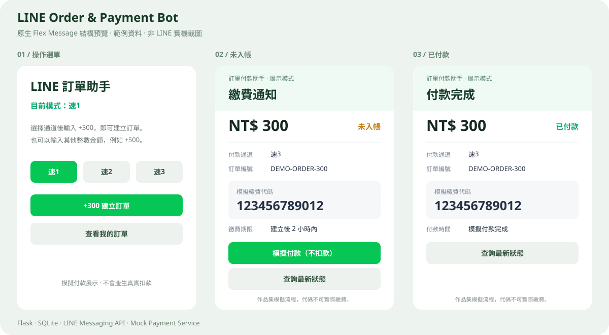
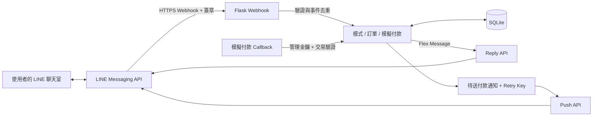

# LINE Order & Payment Bot

**以 LINE 聊天室為操作介面的訂單與模擬付款系統。**

使用者透過 LINE 官方帳號切換通道、建立訂單、查看繳費代碼與查詢付款狀態。後端以 Flask 接收 Webhook、SQLite 保存資料，並用 LINE 原生 Flex Message 呈現互動卡片。

A portfolio project demonstrating a native LINE bot with Flask, SQLite, Flex Messages, webhook verification, and a mock payment lifecycle.

[](https://github.com/liyas1022/line-order-payment-bot/actions/workflows/tests.yml)


> 本專案為作品集展示。付款使用 Mock Payment Service，不會實際扣款，產生的代碼也不能用於超商繳費。

## 卡片預覽



以上由專案內的 Flex Message 範例 JSON 產生，使用示範資料；並非 LINE 實機截圖。實際排版以 LINE 客戶端為準。

原生訊息範例：[操作選單](examples/menu-flex.json) · [未入帳卡片](examples/unpaid-flex.json) · [已付款卡片](examples/paid-flex.json)。可將各檔案的 `contents` 匯入 [官方 Flex Message Simulator](https://developers.line.biz/flex-simulator/)。

## 功能

| 操作 | 行為 |
| --- | --- |
| `/模式` | 顯示原生 LINE 操作選單與 Quick Reply |
| `/速1`、`/速2`、`/速3` | 切換開單通道，模式保存至 SQLite |
| `+300`、`+500` | 建立指定整數金額的訂單，回覆繳費卡片 |
| 訂單編號、繳費代碼、`/查單 訂單編號` | 查詢自己的訂單 |
| `我的訂單`、`/最近` | 以卡片輪播顯示自己的最近五筆訂單 |
| 卡片的「模擬付款」按鈕 | 驗證訂單擁有者，更新狀態並回覆已付款卡片 |
| 付款 Callback | 驗證通道、金額與狀態，更新資料並推送通知 |

```text
/模式 → 選擇速3 → +300 → 未入帳卡片
                            ↓ 模擬付款
                        已付款卡片 → 查詢最新狀態
```

LINE 中的舊訊息不會隨資料庫變動原地改寫；付款或查單時，Bot 會送出含最新狀態的新卡片。

## 系統架構



Webhook 在資料庫交易內保存事件與預定回覆，再呼叫 LINE API。重送相同事件時會沿用既有結果，以避免重複開單。付款通知則保存固定 retry key，支援 Callback 重試。

更完整的處理順序、資料表及取捨，請見 [系統設計](docs/architecture.md)；專案介紹範例請見 [作品介紹](docs/portfolio.md)。

## 快速開始

需求：Python 3.10 以上、已啟用 Messaging API 的 LINE 官方帳號，以及能轉送到本機的 HTTPS 網址。

```bash
git clone https://github.com/liyas1022/line-order-payment-bot.git
cd line-order-payment-bot
python -m venv .venv
```

啟用虛擬環境並安裝套件：

```powershell
# Windows PowerShell
./.venv/Scripts/Activate.ps1
python -m pip install -r requirements.txt
Copy-Item .env.example .env
```

```bash
# macOS / Linux
source .venv/bin/activate
python -m pip install -r requirements.txt
cp .env.example .env
```

在 `.env` 填入自己的設定：

```dotenv
LINE_CHANNEL_SECRET=your-channel-secret
LINE_CHANNEL_ACCESS_TOKEN=your-channel-access-token
PUBLIC_BASE_URL=https://your-public-host
ENABLE_MOCK_PAYMENT=true
DEMO_ADMIN_KEY=
HOST=127.0.0.1
PORT=5000
```

```bash
python app.py
```

Windows 也可使用 `./start.ps1` 建立虛擬環境、安裝相依套件並啟動。首頁 `http://127.0.0.1:5000/` 顯示設定狀態，主要操作在 LINE 聊天室完成。

### 連接 LINE

1. 以 HTTPS 主機或 tunnel 將請求轉送到本機 `5000` port。Windows 的 `./start_tunnel.ps1` 會在專案內下載 ngrok；需先設定自己的 ngrok 帳號 authtoken。
2. 將公開網址填入 `.env` 的 `PUBLIC_BASE_URL`，不包含 `/line/webhook`，並重新啟動 Bot。
3. 執行 `python check_line.py`，驗證 Token 與原生卡片格式。
4. 執行 `python connect_line.py`，讓 LINE 測試新網址；此指令只顯示切換計畫。
5. 要讓該官方帳號使用此專案時，執行 `python connect_line.py --apply`。原設定會備份到 `.demo-run/webhook-before-line-bot.json`。
6. 在 LINE Developers Console 的 Messaging API 頁面確認 **Use webhook** 已開啟；關閉與 Bot 功能重複的官方帳號自動回應及歡迎訊息。
7. 加入自己的官方帳號，傳送 `/模式` 開始操作。

完整 Webhook URL 格式：

```text
https://your-public-host/line/webhook
```

本機展示時，電腦、Bot 與 tunnel 需保持執行；更換 tunnel 網址後也需要更新設定。GitHub 儲存庫提供原始碼，不會自動託管這個 Python 後端。

## Callback 與端點

| 端點 | 用途 | 驗證 |
| --- | --- | --- |
| `POST /line/webhook`、`POST /callback` | LINE 訊息、加入好友與 Postback 事件 | LINE HMAC-SHA256 簽章 |
| `GET /health` | 服務與最近事件處理狀態 | 不含訂單內容或金鑰 |
| `/api/line`、`/api/orders`、`/api/mock/pay/<identifier>` | 管理端測試 | `X-Demo-Admin-Key` |
| `POST /smse1/roturl` | 速1 付款 Callback | 管理金鑰及交易資料驗證 |
| `POST /smse3/roturl` | 速2 付款 Callback | 管理金鑰及交易資料驗證 |
| `POST /smse4/roturl` | 速3 付款 Callback | 管理金鑰及交易資料驗證 |

管理端點需在 `.env` 設定 `DEMO_ADMIN_KEY`；未設定時拒絕存取。Callback 接收 `Data_id`、`Amount`、`Status=PAID`、`Payment_no`。付款通知失敗時，可重送相同 Callback 重試。

原始通道名稱沿用 `smse1_api`、`smse3`、`smse4`，介面分別顯示速1、速2、速3。

## 測試與驗證

```bash
# 本機測試，不會向真實 LINE 使用者傳訊
python -m unittest discover -s tests -v

# 只產生範例，不需要 LINE 金鑰
python check_line.py --export-only
python tools/render_flex_preview.py

# 需要自己的 LINE 金鑰；驗證格式與 Webhook，不傳送聊天訊息
python check_line.py --test-webhook
```

六組測試涵蓋三種通道、使用者訂單隔離、簽章拒絕、模式持久化、Webhook 重送與網路失敗後重試、金額與狀態檢查，以及付款通知的重試與去重。GitHub Actions 在 Windows 與 Linux 執行測試，並檢查範例產生結果。

## 專案檔案

```text
app.py                       Flask、LINE 整合與訂單邏輯
check_line.py                Token、Flex Message 與 Webhook 檢查
connect_line.py              Webhook 切換計畫與套用
requirements.txt             Python 相依套件
.env.example                 不含真實金鑰的設定範本
examples/                    LINE 原生 Flex Message JSON
tests/                       隔離資料庫及網路的本機測試
docs/                        架構、作品介紹與預覽圖
tools/render_flex_preview.py  從範例 JSON 產生卡片結構預覽
.github/workflows/tests.yml   自動測試
```

## 設計範圍

- 每位使用者的模式與訂單獨立保存；群組操作會引導回一對一聊天室。
- 金額以整數處理；時間使用臺北時區（UTC+8）。
- `.env`、真實訂單資料庫、虛擬環境及執行日誌不納入版本控制。
- `ENABLE_MOCK_PAYMENT=false` 可隱藏並停用聊天內的模擬付款功能。
- 此版本同步處理 Webhook，SQLite 適合本機及低流量展示。擴展時可加入背景佇列、正式資料庫及通知排程。
- 尚未串接真實金流。正式交易需另接支付業者並依其規範實作簽章、交易核對與對帳；目前管理金鑰僅供示範。

## 官方文件

- [建立 LINE Bot](https://developers.line.biz/en/docs/messaging-api/building-bot/)
- [Webhook 簽章驗證](https://developers.line.biz/en/docs/messaging-api/verify-webhook-signature/)
- [Flex Messages](https://developers.line.biz/en/docs/messaging-api/using-flex-messages/)
- [API 重試與 Retry Key](https://developers.line.biz/en/docs/messaging-api/retrying-api-request/)
- [Messaging API 參考](https://developers.line.biz/en/reference/messaging-api/nojs/)
