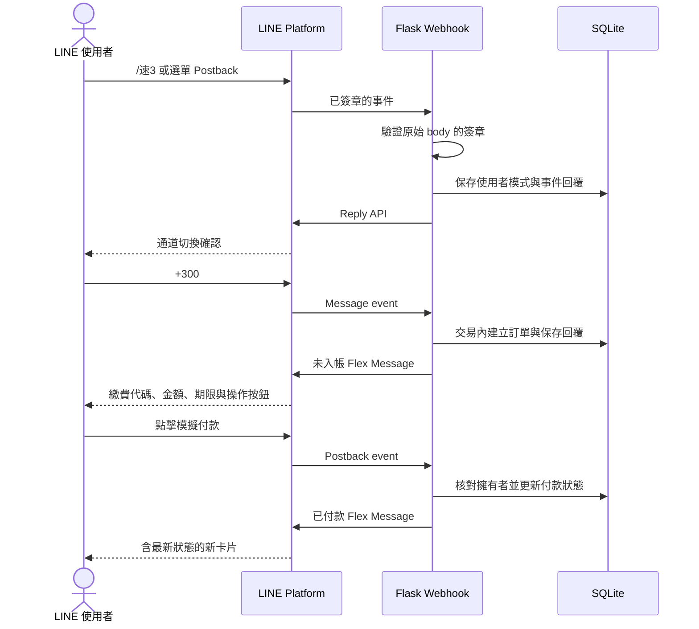
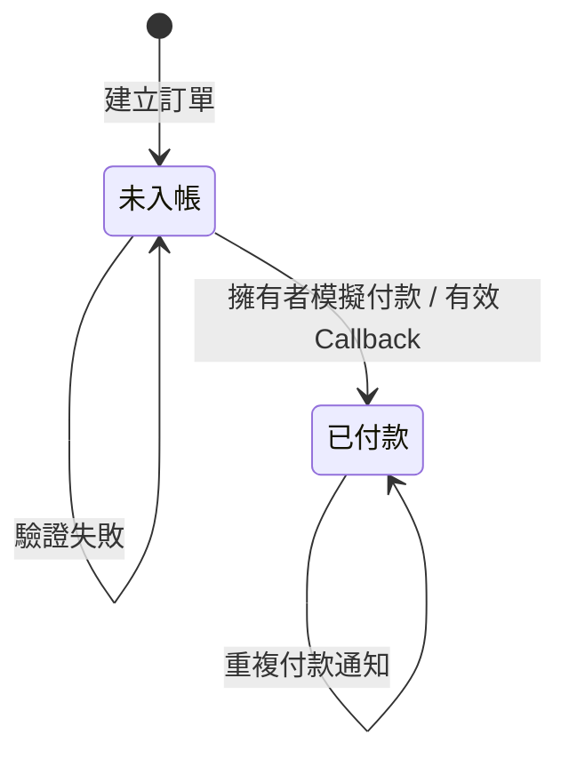

# 系統設計

## 核心流程

使用者只需在 LINE 一對一聊天室操作。通道切換、開單、查單與模擬付款共用同一組訂單邏輯；Flex Message 作為互動介面，SQLite 保存狀態。

## 資料表

| 資料表 | 用途 | 去重或關聯方式 |
| --- | --- | --- |
| `orders` | 訂單、繳費代碼、擁有者與付款狀態 | 唯一的 `data_id`，以 `owner_user_id` 隔離使用者 |
| `user_modes` | 每位使用者選擇的通道 | `user_id` 主鍵 |
| `webhook_events` | 已處理事件、預定回覆與回覆時間 | `event_id` 主鍵 |
| `payment_notifications` | 外部 Callback 所產生的付款通知 | `data_id` 主鍵與固定 `retry_key` |

既有展示版資料庫如缺少 `owner_user_id`，啟動時會加入欄位。沒有擁有者的舊訂單不會出現在任何 LINE 使用者的訂單列表。

## Webhook 與一致性

1. 以 Channel secret 和未修改的原始 request body 計算 HMAC-SHA256，再比對 LINE 簽章。
2. 對支援的事件開啟 SQLite `BEGIN IMMEDIATE` 交易。
3. 若事件已回覆，直接略過；若已保存但尚未回覆，沿用既有回覆。
4. 新事件在同一交易內更新模式或訂單，並保存 `reply_json`。
5. 交易提交後呼叫 Reply API，再記錄回覆時間。

LINE API 失敗時回傳 503。若 LINE 已啟用 Webhook redelivery，相同事件重送時會沿用已保存的訂單與回覆，避免再次開單。

Reply token 有使用期限且只能使用一次；若 LINE 已接收回覆但回應在網路上遺失，伺服器不一定能判斷該回覆是否已送達。訂單資料仍可透過下一次查單取得。

## 付款狀態與通知

付款更新使用 `WHERE is_paid=0`，重複通知不會覆寫既有付款時間與交易編號。

聊天室內的模擬付款透過 Reply API 回覆。管理端付款與外部 Callback 則先保存待送通知，再透過 Push API 通知訂單擁有者。若 Push 失敗，重送 Callback 會使用相同 `X-Line-Retry-Key` 重試；尚未加入常駐排程工作者。

## 安全與取捨

- LINE 使用者身分取自通過驗證的 Webhook，不由卡片參數自行指定。
- 查詢與付款都會核對訂單擁有者。群組訊息不提供訂單操作。
- 管理 API 與付款 Callback 使用獨立管理金鑰；預設未設定，端點拒絕存取。
- 真實金鑰、訂單資料、Webhook 備份與日誌留在本機，不發布至 GitHub。
- SQLite 交易與事件去重適合低流量作品展示；高併發部署可遷移至正式資料庫並拆出事件佇列。
- 本專案只模擬支付事件，不主張已完成真實支付平台的交易驗證、對帳或正式上線要求。
